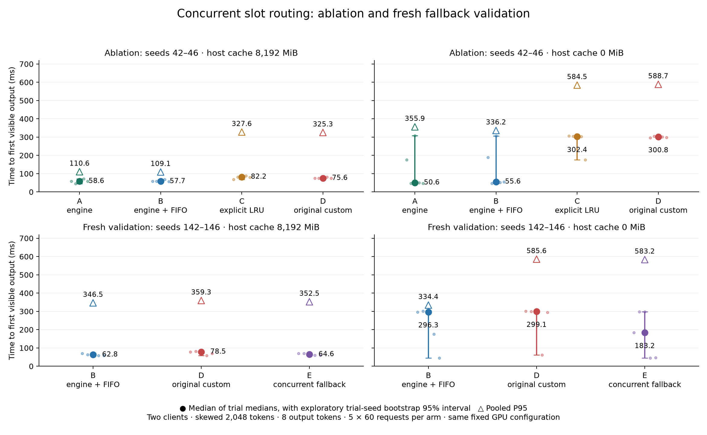

# Phase 2 — Concurrent conversation scheduling

## Outcome

The regression is reproducible, and the evidence identifies **premature explicit slot binding plus engine-side queueing/batching**, rather than FIFO wait or a necessary flaw in frequency-weighted eviction. Rust chooses from its client-visible idle slots before HTTP dispatch. llama.cpp may process that task later, after another slot becomes idle with a much better matching prefix. Explicit `id_slot` prevents native reconsideration. An observed unnecessary prefill then delays a nearly fully cached request.

An opt-in `corrected` mode removes that early binding under concurrency while retaining FIFO admission and the original sequential policy. **It is not a verified overall performance optimization.** Fresh trials improve some medians, but do not establish reliable P95 parity with stock. Stock remains the recommended concurrent policy. All original results are preserved.

## Evidence

The clean ablation has five paired seeds × 60 measured requests × four arms × two cache settings: **2,400 measured attempts**, with zero failures and 240 separately labeled warmups. It holds client concurrency at two and output length at eight tokens. The original project's stock arm already includes the Rust FIFO semaphore, so it corresponds to B below.

| Host cache MiB | Arm | Median TTFT ms | P95 ms |
|---:|---|---:|---:|
| 8192 | A: engine routing, no semaphore | 58.61 | 110.56 |
| 8192 | B: engine routing + FIFO | 57.70 | 109.07 |
| 8192 | C: explicit prefix/LRU | 82.17 | 327.65 |
| 8192 | D: original custom | 75.57 | 325.27 |
| 0 | A: engine routing, no semaphore | 50.57 | 355.85 |
| 0 | B: engine routing + FIFO | 55.57 | 336.22 |
| 0 | C: explicit prefix/LRU | 302.36 | 584.46 |
| 0 | D: original custom | 300.77 | 588.74 |

Median means the median of five trial medians; P95 pools successful requests. In every no-host-cache trial, C and D have **identical evaluated-token totals**. FIFO queue medians are below one microsecond; custom routing decisions take approximately 1.5 microseconds. These cannot directly explain hundreds of milliseconds of TTFT.

The separate detailed-log cohort contains a concrete chain:

1. Rust reserves slot 0 for request 10 (conversation B).
2. Slot 1 finishes its previous B task before engine selection. Its reconstructed prefix matches 2,034 input tokens.
3. Explicit routing still selects slot 0, reusing only four tokens and evaluating 2,044.
4. Request 11 reuses 2,034 tokens but waits **287.84 ms from engine POST to launch** behind that work. Its visible TTFT is **326.07 ms**, despite its own prompt timing being only **36.636 ms**.

Across five verbose no-host-cache custom trials, 27 measured requests have this kind of missed longer idle-prefix opportunity; conservative clock bounds establish that the alternate slot became idle after Rust's reservation in all 27. This is observed availability and prefix evidence, not a simulated alternate-run speedup. Native source confirms explicit assignment restricts prefix selection, and completion tasks can be declined while decode is in flight. No unavailable-slot defer events were found in that cohort. See [root-cause analysis](docs/concurrency-root-cause.md) for request IDs, exact timestamps, source checks, hypotheses and remaining uncertainty.

## Change and fresh validation

The original `custom` mode remains intact. The new `corrected` mode uses explicit custom prefix routing for concurrency 1, and native `id_slot = -1` for concurrency greater than 1. It retains the same fair semaphore and cache settings. There is no early lease release, cached-answer substitution, engine-state mutation or change to llama.cpp's validation of KV reuse. Tests exercise stale client reservations, routing selection, engine wait versus FIFO wait, cancellation and permit return.

Fresh seeds 142–146 were prepared using the same tokenizer/template. Five paired trials × 60 requests × B/D/E × both cache budgets provide **1,800 measured attempts** and 180 warmups:

| Host cache MiB | Arm | Median TTFT ms | P95 ms | Failed attempts |
|---:|---|---:|---:|---:|
| 8192 | B: stock + FIFO | 62.77 | 346.49 | 0/300 |
| 8192 | D: original custom | 78.48 | 359.33 | 1/300 |
| 8192 | E: concurrent fallback | 64.59 | 352.49 | 0/300 |
| 0 | B: stock + FIFO | 296.32 | 334.39 | 0/300 |
| 0 | D: original custom | 299.13 | 585.61 | 0/300 |
| 0 | E: concurrent fallback | 183.25 | 583.19 | 0/300 |

The failure is a retained custom request whose connection closed before headers. Latency statistics condition on success; it is neither retried nor given zero latency. All warmups succeeded. New seeds and run conditions differ from the ablation, so compare policies within each cohort rather than claiming that a change from one cohort's absolute median is a treatment effect.

The paired median change E versus D is **−13.90%** at 8,192 MiB (exploratory 95% interval **[−18.35%, +2.04%]**) and **−27.05%** at 0 MiB (**[−84.04%, −0.58%]**). Negative means lower latency. These are medians of paired trial percentage changes, not percentages computed from the displayed medians.

The tail result prevents a broad success claim. With host caching disabled, stock has 13/300 requests over 500 ms, fallback 17/300 and original custom 27/300. That small tail crosses the pooled 95th-percentile cutoff for fallback but not stock. E/B pooled P95 increases **74.40%**, with an exploratory paired whole-trial bootstrap interval **[−0.09%, +79.59%]**. The median paired *per-trial* P95 increase is only 1.60%; reporting that alone would conceal the pooled regression. E and B have the same concurrent routing semantics, but these independently timed executions do not establish empirical tail parity. The residual scheduling/interleaving variance remains unresolved.



The figure shows five trial median points, exploratory trial-bootstrap intervals, and pooled P95 triangles. [Full tables and protocol](docs/concurrency-ablation.md) include token counts, scheduling overhead and failure accounting. [Machine-readable results](DATA_ARCHIVE.md) retain every trial and both P95 estimands.

## Correctness investigation

Separate concurrent 32-token, EOS-enabled probes comprise **720 measured attempts**, with zero request failures. Factual passes range from **117 to 118 of 120** per policy/cache group; none returns another known conversation's code. Against B, E has four greedy token mismatches with host caching enabled and zero without; D has four and three respectively. Some mismatches are verbose versions of the correct answer. Others are factual errors, including `I-007`, `I-452` and `I-523` in place of `A-796`. These are retained, not classified automatically as cache corruption or dismissed as harmless formatting.

An additional audit replays the ten distinct disputed/control prompts with **zero cached tokens**, twice sequentially and twice under two-client concurrency: **40 requests**. Native counters confirm full input evaluation. `I-007` recurs in all four uncached repetitions of that prompt, so at least this shared error is model behavior independent of KV reuse. Prompt inspection confirms the expected code and intact role markers. The uncached concurrent controls also reproduce verbose-answer variation. The other two wrong codes do not recur in these controls. Their exact source remains unresolved; batching, recomputation and numerical variation are possible, not proven explanations. There is no evidence here of cross-conversation code leakage, but **bitwise greedy equivalence and perfect factual correctness are not established**.

Raw controls and decoded prompt boundaries are in [`phase2/probe-audit`](DATA_ARCHIVE.md). This audit uses native nonstreaming responses and is correctness evidence, not TTFT evidence.

## Reproducibility and limits

The configuration remains b11960 commit `8642541b255bfb5dc39cd351a178be09013a55d6`, official Windows CUDA 12.4 runtime/binaries, Qwen2.5-3B-Instruct Q4_K_M, two 6,144-token slots, full GPU offload, f16 KV, flash attention on, batch 2,048, context shifting disabled and fit off. Driver, checksums, full arguments, client binary identity and fixture hashes are saved per arm. A setup check rejects insufficient VRAM rather than changing configuration.

Schema-2 request traces distinguish directly measured client timing, engine log intervals and inferred cross-clock/task joins. Exact server network acceptance is unobservable and remains null. Raw SSE events, output tokens, cache/evaluation/prefill/decode counters and errors are retained. Token sums reconcile with native metrics for complete successful arms, including warmups. Metric endpoint gauges cannot reconstruct transient queueing.

The earlier detailed-log, partial normal-log and frozen-client replay cohorts remain separate. One normal-log collection stopped after 22 arms because browser VRAM use exhausted the setup headroom. Clean cohorts followed closing Edge, but frozen replays still varied; this does not prove that Edge caused the original ratio. Native log overhead, desktop GPU activity, thermals and two-client closed-loop interleaving constrain causal timing attribution. One-second GPU/RAM/temperature/power/clock telemetry misses brief peaks and includes startup/warmup. Lower recomputation is not evidence of lower VRAM. No CUDA-kernel attribution, general multi-model benefit or open-loop fairness/performance claim is made.

## Reproduction and checks

Use the existing environment and saved fixtures. Fresh `--out` paths avoid overwriting evidence:

```powershell
cargo test --all-targets
cargo clippy --all-targets -- -D warnings
cargo build --release --bins
.venv\Scripts\python.exe scripts/concurrency_experiment.py --suite ablation --trials 5 --requests 60 --verbosity 3 --out phase2/reproduce-ablation
.venv\Scripts\python.exe scripts/concurrency_experiment.py --suite validation --trials 5 --requests 60 --verbosity 3 --arms fifo custom corrected --workloads phase2/workloads --seed-start 142 --out phase2/reproduce-validation
.venv\Scripts\python.exe scripts/concurrency_experiment.py --suite correctness --trials 2 --requests 60 --verbosity 3 --arms fifo custom corrected --workloads phase2/workloads --seed-start 142 --out phase2/reproduce-correctness
.venv\Scripts\python.exe scripts/concurrency_report.py
.venv\Scripts\python.exe -m unittest discover -s tests -v
.venv\Scripts\python.exe scripts/concurrency_audit.py
```

`concurrency_report.py` regenerates the canonical saved-data tables and chart. The detailed [ablation document](docs/concurrency-ablation.md) explains separate diagnostic regeneration and how to analyze fresh collections. The probe audit refuses to overwrite its prior evidence. Checks passed: formatting, **16 Rust tests**, Clippy with warnings denied, and **4 Python evidence/overlap tests**. Original evidence preservation and final fingerprints are recorded in [`phase2/integrity.json`](DATA_ARCHIVE.md). No push, publication or unrelated-project modification was performed.
