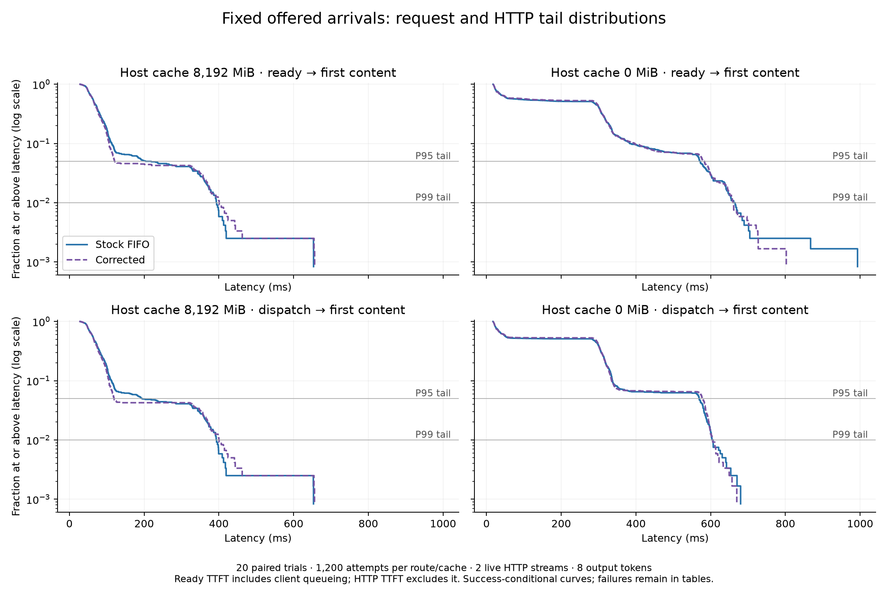
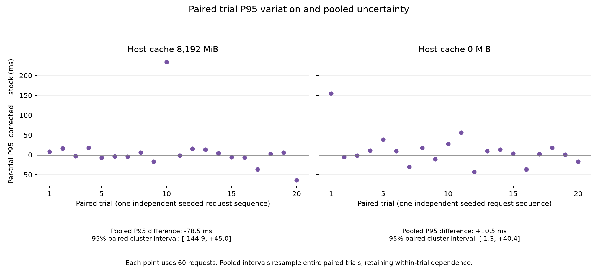
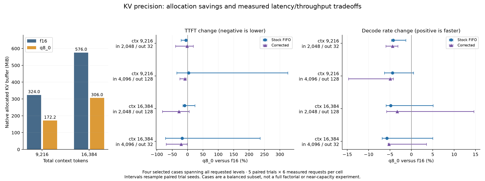

# Phase 3 — Routing equivalence, tail variability and release preparation

As of October 29, 2026 (America/Toronto).

## Finding

Under two-client concurrency, stock FIFO and corrected mode have the same native inference semantics. Tests against the preserved Phase 2 implementation and **2,640 live paired request-body comparisons** found no difference in prompts, sampling, cache controls, slot selection or server parameters. Both send `id_slot = -1` and use the same fair semaphore. The corrected label is a concurrent fallback to native scheduling, not a distinct native algorithm.

Twenty paired fixed-arrival trials do **not** establish an intrinsic latency advantage for either label. With host caching disabled, the pooled P95 change is **+1.84%**, with an exploratory paired-trial 95% interval **[−0.24%, +8.75%]**, inside the declared ±10% margin for the all-trial comparison. Its failure-free sensitivity is wider and does not meet that margin. With host caching enabled, the P95 ranking flips between the initial and extended samples and remains unresolved. A large point estimate from that setting must not be presented as a scheduler speedup.

<!-- PRECISION_FINDING_START -->

The independent repeated precision study finds a clear allocation tradeoff: q8_0 reduces the native KV buffer by about **46.9%**, while paired per-stream decode-rate point estimates are **3.34–5.70% lower**. TTFT changes are mixed and uncertain. All selected EOS factual probes pass, but token sequences and cold numerical outputs differ. Compression is not reported as an automatic speedup.

<!-- PRECISION_FINDING_END -->

## Why the earlier P95 discrepancy is not evidence of different routing

[The equivalence review](docs/phase3-equivalence.md) traces the actual request, permit, state and completion paths. Neither two-client mode reserves or mutates a Rust slot. Captured HTTP bodies/headers and ordered event names agree; cancellation returns permits without changing routing metadata. The original main CLI intentionally retains custom routing only for corrected mode at concurrency 1.

Phase 2's independently timed closed-loop runs were different realizations of equivalent routing. Completion timing determined future offered work, and synchronous row flushing sat between completions and later dispatches. In its constrained validation, 13 versus 17 requests above 500 ms out of 300 crossed the pooled P95 cutoff, yielding 334 versus 583 ms despite the same inference semantics. That arithmetic explains the sensitivity of the percentile, not a complete physical attribution for each extra slow request.

Phase 3 removes completion dependence from offered arrivals and buffers trace writes outside dispatch progression. It still observes native runtime interleaving, cache-state trajectories, wakeup jitter, transport errors and laptop variability. The default-caching runs evaluated exactly **70,843 measured input tokens** under each label and reused **2,386,757** each, yet their pooled P95 point estimates differ. Equal token totals do not fix request ordering, engine waiting or memory-copy overlap.

The evidence rules out a payload/routing distinction as the explanation. It supports percentile sensitivity and runtime variability, but does **not** conclusively attribute the remaining host-cached P95 variation to a particular CUDA synchronization event, HTTP pool race or OS timer mechanism. Those explanations remain hypotheses. No kernel-level cause or universal performance equivalence is invented.

## Controlled arrival experiment

The [protocol](DATA_ARCHIVE.md) was written before measurement. Start with ten paired seeded trials, then expand to twenty if the paired pooled P95 interval spans over 20 percentage points or P99 over 30. The host-cached P95 triggered that expansion. Twenty was the declared sample cap, not a rule to stop only after a favorable result. The initial cohort, sample decision and extended data all remain available.

Each arm has six separate warmups and 60 measured requests. Seeds 242–261 use saved synthetic 2,048-token histories and unchanged scripted continuations. Offered pairs arrive at offsets 0/10 ms every 600 ms; a FIFO dispatcher permits at most two live HTTP streams. A fresh server starts for each arm and treatment order alternates by trial. All runs use eight output tokens, temperature 0, seed 42, EOS ignored, f16 KV, 12,288 total context, two 6,144-token slots, full GPU offload, flash attention, batch 2,048, context shifting disabled and fit off. Host caching is either 8,192 MiB or the separately labeled constrained 0 MiB setting.

This is **80 arms, 4,800 measured attempts and 480 warmup attempts**. Latency percentiles condition on successful measured responses. Failures are not retried or assigned zero latency.

| Host MiB | Route | Ready TTFT median ms | P95 ms | P99 ms | HTTP P95 ms | Client queue P95 ms | Measured failures |
|---:|---|---:|---:|---:|---:|---:|---:|
| 8192 | Stock FIFO | 65.59 | 198.94 | 392.77 | 191.57 | 0.16 | 0/1200 |
| 8192 | Corrected | 65.29 | 120.42 | 399.48 | 119.05 | 0.14 | 0/1200 |
| 0 | Stock FIFO | 284.49 | 570.06 | 655.44 | 569.05 | 90.51 | 2/1200 |
| 0 | Corrected | 290.16 | 580.54 | 657.90 | 577.32 | 87.05 | 3/1200 |

| Host MiB | Route | Over 100 ms | Over 300 ms | Over 500 ms |
|---:|---|---:|---:|---:|
| 8192 | Stock FIFO | 17.58% | 4.00% | 0.17% |
| 8192 | Corrected | 14.58% | 4.17% | 0.17% |
| 0 | Stock FIFO | 55.01% | 41.32% | 6.93% |
| 0 | Corrected | 56.64% | 41.77% | 7.02% |

Rates condition on success. The machine-readable analysis also bounds exceedances over all attempts by treating failed requests as either below or above the threshold. The five measured failures occur in trial 19 with host caching disabled. One additional stock warmup failed in trial 18 with host caching enabled. All six report connection closure before HTTP headers. Their exact transport cause remains unresolved. Whole-pair sensitivity analyses exclude affected trials after preserving the all-trial primary comparison; no failed observation is silently replaced. Engine phase-overlap is unavailable for the failed-warmup arm because its native phase boundary is uncertain.

### Paired uncertainty and unstable ranking

Resample entire paired trials, keeping their 60-request cache/arrival dependence, rather than treating requests as independent. Use 10,000 percentile bootstrap resamples with fixed analysis seed. These are exploratory intervals on one device, with adaptive sample expansion and multiple comparisons, not simultaneous or sequentially adjusted coverage guarantees.

| Host MiB | P95 change, corrected vs stock | 95% interval | P99 change | 95% interval |
|---:|---:|---|---:|---|
| 8192 | −39.47% | [−54.34%, +20.19%] | +1.71% | [−5.25%, +7.50%] |
| 0 | +1.84% | [−0.24%, +8.75%] | +0.38% | [−2.98%, +2.30%] |

At ten trials, the host-cached P95 point change was **+5.15%**; at twenty it was **−39.47%**. The interval remains wide across zero. Excluding the failed-warmup pair gives **−38.69% [−54.40%, +48.71%]**, so that failure alone does not explain the uncertainty. In the constrained setting, removing the pair with measured failures gives **+1.35% [−1.08%, +19.26%]**. Thus its all-trial interval meets the declared margin, but that stronger precision is not robust to the failure-free sensitivity. An interval containing zero is not proof of equivalence; no general tail-parity guarantee is claimed.





Pooled percentiles and per-trial percentile differences are different estimands. Both are retained in [summary.json](DATA_ARCHIVE.md), along with every trial, failure bounds and sensitivity analysis. P95(queue) plus P95(HTTP) is not P95(total); no percentile subtraction is used as an additive causal decomposition.

## Arrival fidelity and engine observability

Saved *offered* arrivals are identical within pairs and independent of completion. Actual creation times are not perfectly on the target clock: median producer lateness is about **6.9–7.9 ms**, with P95 **15.0–15.3 ms**. The harness records that lateness separately. Scheduled-arrival P95 is 208.03/130.68 ms for stock/corrected at 8,192 MiB, and 580.56/586.81 ms with host caching disabled. The ready-to-content headline excludes producer lateness but includes FIFO waiting. This timing imperfection can alter overlap and limits claims of physically identical arrivals. A read-only [timer/power snapshot](DATA_ARCHIVE.md) after collection reports 1 ms current system timer resolution and Balanced power mode; it does not explain the observed wakeups or establish per-process resolution throughout the study. No system timer or power setting was changed.

Separate short verbose diagnostics validate 18 request/task matches per arm using exact generated token IDs and evaluated-token counts. Direct engine POST→launch P95 ranges from **43.74 to 263.68 ms** across those four arms. This includes waiting and preparation, including cache work, and is not exact network acceptance or isolated GPU execution. The normal-log headline data do not claim that fine-grained request join. Native batching gauges, engine active intervals and one-second GPU temperature, power, clocks and memory samples are retained. [Diagnostic evidence](DATA_ARCHIVE.md)

## Independent KV precision study

<!-- PRECISION_RESULTS_START -->

Four preregistered selected context/input/output cases span 9,216/16,384 total context, 2,048/4,096 input and 32/128 output tokens. Crossing both precisions and both routing labels gives **80 timing arms**, with five paired trials per cell, six measured requests and two warmups: **480 measured attempts and 160 warmups**. A separate 20-arm EOS-enabled study contributes 120 measured factual probes and 40 warmups. Both collections have zero request failures.

| Total context | f16 allocated KV MiB | q8_0 allocated KV MiB |
|---:|---:|---:|
| 9216 | 324.00 | 172.15 |
| 16384 | 576.00 | 306.03 |

The model buffer remains 1,834.83 MiB. Native allocation is measured outside normal-log timing; ready GPU usage and one-second timed-window system maxima are sampled in every trial. A smaller KV allocation does not imply the same percentage reduction in total VRAM. This is an allocation comparison with headroom, not a near-capacity test.

All eight paired decode-rate point estimates regress **3.34–5.70%** with q8_0; several intervals include a benefit, so the evidence does not support an invariant penalty either. TTFT sometimes improves and sometimes regresses, with wide intervals and some different cache/evaluation counts. For example, the 9,216/2,048/32 stock comparison has a **−4.24%** per-stream decode-rate change **[−4.65%, −1.32%]**. The 9,216/4,096/128 stock TTFT change is **+3.30% [−35.17%, +326.12%]**. No universal latency improvement is claimed.

Across fixed-length timing outputs, **197/240 paired f16/q8_0 sequences differ**, versus **14/240 same-precision label controls**. Separate cold first-token controls observe four argmax changes in forty paired cells and retain top-eight pre-sampling log probabilities. These repeated cells are not forty independent prompts. All **120 selected EOS-enabled factual probes pass**; four of sixty paired precision sequences differ only by a verbose versus concise correct answer. This does not establish correctness outside that selected case, and timing-output factual failures remain visible.



The [precision report](docs/kv-cache-precision.md) contains the exact selected design, per-case tables, paired uncertainty, numerical details, native allocation and sampled-memory limits. [Raw precision summary](DATA_ARCHIVE.md) and [EOS controls](DATA_ARCHIVE.md) preserve regressions and output differences. The selected matrix is not a full factorial and cannot isolate every context/input/output interaction.

<!-- PRECISION_RESULTS_END -->

## Release and reproduction

The updated [README](README.md) gives the complete initial baseline → custom policy → regression → investigation → fallback → validation story, exact commands and evidence links. The original README is archived; all prior source, raw results, charts and reports remain intact. New [application material](docs/loci-application.md) and [interview explanations](docs/interview-walkthrough.md) distinguish native gains from the Rust policy and explain the negative findings.

Reproduce into fresh paths using the README. To regenerate the canonical retained-data analysis and figures after collection:

```powershell
.venv\Scripts\python.exe scripts/phase3_analyze.py
.venv\Scripts\python.exe scripts/phase3_hardware.py
.venv\Scripts\python.exe scripts/phase3_precision_analyze.py
.venv\Scripts\python.exe scripts/phase3_precision_analyze.py --source phase3/precision-correctness --out phase3/precision-correctness-analysis
.venv\Scripts\python.exe scripts/phase3_report.py
cargo test --all-targets --locked
cargo clippy --all-targets --locked -- -D warnings
.venv\Scripts\python.exe -m unittest discover -s tests -v
.venv\Scripts\python.exe scripts/phase3_audit.py
```

All request payloads, fixture hashes, binary identities, server/model/runtime checksums, driver and launch arguments are retained. Exact network acceptance is unavailable and stays null. Native cache/evaluation counters are reconciled against request inputs and full-arm metrics where responses are complete. Output disagreements are inspected without equating every mismatch with cache corruption. Buffered traces could be lost on an interrupted client; complete arms are checked for all planned records, and no interrupted arm is represented as complete.

Final checks pass: formatting, Clippy with warnings denied, **25 Rust test executions across targets** (including reused shared-path tests) and **6 Python tests**. The raw-data and preservation audit is in [phase3/integrity.json](DATA_ARCHIVE.md). Generated evidence regions in this report, README and the precision document can be refreshed with `scripts/phase3_release_docs.py` after regenerating their source summaries; original Phase 1/2 reports are never rewritten.

Limitations include one laptop/model, synthetic histories, fixed partitions, imperfect timer wakeups, sparse tails, transport failures, startup/thermal carryover and system-wide sampled memory. No near-capacity, production-load, custom-CUDA or multi-device claim is made. Stock native routing remains the practical recommendation; corrected concurrent mode supplies no separate native scheduling algorithm. No push or publication was performed.
