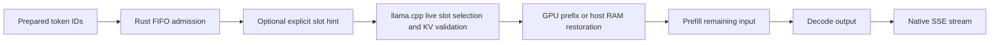
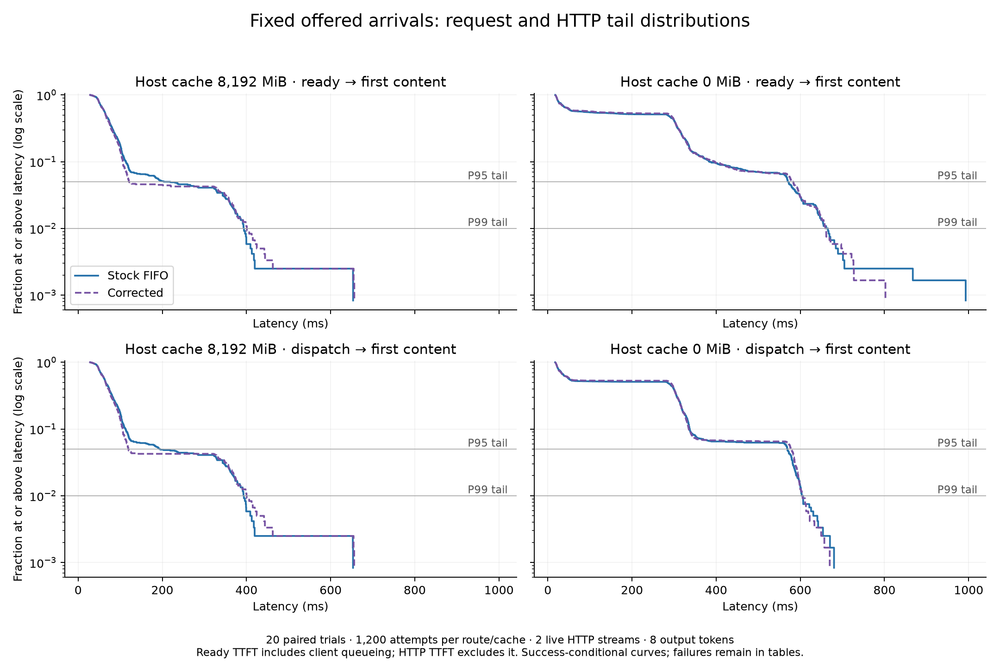

# Loci Cache Lab

**Can a Rust conversation scheduler improve time to first token beyond llama.cpp's existing caching on an 8 GB GPU?**

This study found a concurrency regression, traced a premature slot-binding mechanism, and tested a native-routing fallback. **No reliable independent speedup from the corrected concurrent mode is established.** The project includes negative results, failures and numerical disagreements.

For a ten-minute review: read the findings below, inspect [the scheduler](src/scheduler.rs), run the [mini-demo](docs/DEMO.md), then read the [case study](docs/CASE_STUDY.md) or [nine-slide presentation](presentations/engineering-case-study.pptx).

## 1. Research question and motivation

Three active conversations compete for two inference slots. A retained prefix can avoid expensive input processing, but a client-side slot decision can also discard a better prefix or delay other work. The original hypothesis was that retaining expensive, frequently requested histories would improve interactive latency.

Hardware: **RTX 4070 Laptop GPU, 8 GB**, Core i9-14900HX, 32 GB RAM, Windows. Model: **Qwen2.5-3B-Instruct Q4_K_M**. Engine: official **llama.cpp b11960 Windows x64 CUDA 12.4** binaries with matching runtime, commit `8642541b255bfb5dc39cd351a178be09013a55d6`. [Pinned identities](environment/artifacts.json)

## 2. Pipeline and caching bottleneck



Prefill evaluates input tokens and builds KV state. Decode uses that state to generate output. Native prefix matching and the host-RAM prompt cache already avoid substantial work. A warm request can still wait behind another request's prefill. Cache-hit totals alone do not determine TTFT.

## 3. Rust architecture

[Scheduler](src/scheduler.rs): choose the longest matching idle token prefix above the native 10% threshold. Otherwise use an empty slot or minimize `known_cached_tokens × frequency_in_previous_32_admissions`, with recency and slot-ID ties. This is a retention heuristic, not a future-request oracle or calibrated cost model.

[Client](src/main.rs): Tokio/Reqwest native streaming `/completion`, a fair semaphore, and slot leases held through completion. Errors/cancellation invalidate uncertain hints. [SSE parser](src/sse.rs) handles split events, UTF-8 boundaries and empty initial chunks. llama.cpp validates all actual KV reuse and generates every answer.

[Phase 2 harness](src/bin/concurrency.rs) preserves the ablation. [Fixed-arrival harness](src/bin/phase3.rs) separates offered arrivals from completion-driven dispatch. [Precision harness](src/bin/precision.rs) reuses that request/parser path. Historical source stays unchanged.

## 4. Baseline and methodology

The repeated 2,048-token control measured **285.5 ms uncached versus 18.3 ms with stock caching**. This gain belongs to llama.cpp, not the Rust scheduler. [Original report](docs/REPORT.md)

Comparisons use fixed synthetic histories and scripted continuations. Generated answers never become later benchmark prompts. Paired arms share tokenized inputs, sampling and output limits, with fresh servers and rotated treatment order. Main timing uses two slots, f16 KV, full offload, 12,288 total context, flash attention, batch 2,048, context shifting off and `--fit off`. Eight-token timing ignores EOS; separate factual probes allow EOS.

The main comparison preserves the 8,192 MiB host-RAM cache. Host-cache-disabled results are a constrained configuration. The fixed-arrival study has twenty paired trials per cache setting and 60 measured requests per arm. It retains five measured connection failures and one warmup failure. Uncertainty resamples whole paired trials, preserving request dependence.

## 5. Concurrency regression and root cause

The clean no-host-cache ablation produced median-of-trial-medians TTFT of **55.57 ms stock + FIFO**, **302.36 ms explicit prefix/LRU**, and **300.77 ms original custom**. P95 was 336.22/584.46/588.74 ms. Replacing frequency retention with LRU did not cure the regression. FIFO wait and routing computation cost microseconds.

Rust commits to a slot before dispatch. Native admission may occur later, after another slot becomes idle with a longer prefix. In a validated diagnostic, the pinned request reused **4 tokens** and evaluated **2,044**, despite another idle slot matching **2,034 tokens**. The next nearly cached request waited **287.84 ms from native POST to launch**.

[Recorded trace](evidence/early-binding.json) · [Ablation data](evidence/phase2-summary.json) · [Root-cause report](docs/concurrency-root-cause.md)

The alternate prefix is a reconstructed routing opportunity, not a measured alternate-run speedup. Detailed-log timing remains separate from headline runs.

## 6. Corrected routing and tail validation

`corrected` mode keeps the sequential custom policy but delegates concurrent selection using **`id_slot = -1`** and the same FIFO semaphore. It is a fallback to stock semantics, not an independently optimized concurrent algorithm. Tests exercise the actual preserved Phase 2 paths; 2,640 paired transmitted bodies agree. [Equivalence review](docs/phase3-equivalence.md)

With host caching disabled, stock/corrected P95 was **570.06/580.54 ms**. The all-trial paired change is **+1.84% [−0.24%, +8.75%]**. Excluding the failure-affected pair widens the interval to **[−1.08%, +19.26%]**. With default host caching, the P95 ranking flipped after sample expansion and remains unresolved. No general tail-parity or scheduler-speedup claim follows.



## 7. KV-cache precision tradeoffs

Five paired trials per selected configuration compare f16/q8_0 with total context 9,216/16,384, inputs 2,048/4,096 and outputs 32/128. The four-case balanced subset spans these levels but is not a full factorial.

Native KV allocation falls **324 to 172.15 MiB** and **576 to 306.03 MiB**, about **46.9%**. The model buffer remains unchanged. Paired per-stream decode-rate point estimates are **3.34–5.70% lower** with q8_0; some intervals include improvements. TTFT is mixed. All 120 selected EOS factual probes pass, while numerical and token differences persist. [Precision report](docs/kv-cache-precision.md)

## 8. Findings and limitations

Stock native routing remains the concurrent recommendation. The evidence establishes an early-binding failure mechanism and equivalent fallback requests, while leaving residual default-cache P95 variability unresolved. Equal token counts, a favorable median or a smaller allocation are insufficient proof of an optimization.

One model/laptop and synthetic traces limit generalization. Producer wakeups were imperfect, physical clocks/thermals varied, and transport closures remain unexplained. Greedy outputs can differ across batching/precision. One-second GPU samples include desktop activity and can miss peaks. Different context allocations do not prove operation near VRAM capacity. The [case study](docs/CASE_STUDY.md) separates findings from hypotheses.

## 9. Quick start on Windows

Tested with Python **3.14.6**, Rust **1.96.1 MSVC**, Visual C++ build tools and NVIDIA driver **616.92**. GPU-free unit tests need no model/server. The demo needs the existing pinned assets and at least **3,584 MiB free VRAM**. First downloads/builds are separate from demo runtime.

```powershell
python -m venv .venv
.\.venv\Scripts\python.exe -m pip install -r requirements.lock.txt
cargo build --release --locked --bins
# Only if the model/runtime assets are not already present:
python scripts/setup.py
.\.venv\Scripts\python.exe scripts/demo.py check
.\demo.ps1
```

The isolated release build passed, and one 12-request-per-mode smoke demonstration completed in **25.03 seconds**, with six warmups per mode and no failures. That small sample does not establish a speedup or guarantee a live replay of the timing-sensitive failure. [Separate server/prepare/run commands and recording guide](docs/DEMO.md)

Regenerate a saved-evidence example without a GPU:

```powershell
.\.venv\Scripts\python.exe scripts/plot_evidence.py --out runs/example.png
```

Quality checks:

```powershell
cargo fmt --check
cargo test --all-targets --locked
cargo clippy --all-targets --locked -- -D warnings
.\.venv\Scripts\python.exe -m unittest discover -s tests -v
```

Collectors reject insufficient memory, an occupied port, scope changes and existing output destinations rather than silently changing configuration. They stop only servers they own.

## 10. Evidence and release materials

- [Portable request measurements](evidence/requests.jsonl), [configuration headers](evidence/configurations.json) and [source/hash index](evidence/index.json), including warmups and failures.
- [Phase 3 tail results](evidence/phase3-tail-summary.json), [precision results](evidence/phase3-precision-summary.json), [hardware samples](evidence/phase3-hardware.json).
- [Phase 1 report](docs/REPORT.md), [Phase 2 report](PHASE2_REPORT.md), [Phase 3 report](PHASE3_REPORT.md).
- [Case study](docs/CASE_STUDY.md), [editable presentation](presentations/engineering-case-study.pptx), [recording storyboard](docs/RECORDING_GUIDE.md).
- [Application response and spoken explanation](docs/APPLICATION_RESPONSE.md), [interview bank](docs/INTERVIEW_QUESTIONS.md).
- [Repository audit](docs/REPOSITORY_AUDIT.md), [release checklist](RELEASE_CHECKLIST.md), [final handoff](FINAL_HANDOFF.md), [archive policy](DATA_ARCHIVE.md).

Historical originals remain local and unchanged. The reviewed publication copy normalizes machine locations and redirects archive-only links; its manifest records original and publication hashes. Full traces/configuration are kept in a separate redacted archive. Nothing has been pushed or released. Follow the handoff before publishing instead of adding the entire working directory.

Project code is MIT licensed. **This exact Qwen 3B model uses the Qwen Research License**, separately from project code. Model/runtime binaries are excluded. See [third-party notices](THIRD_PARTY_NOTICES.md) and the [pinned model agreement](https://huggingface.co/Qwen/Qwen2.5-3B-Instruct-GGUF/blob/7dabda4d13d513e3e842b20f0d435c732f172cbe/LICENSE).
