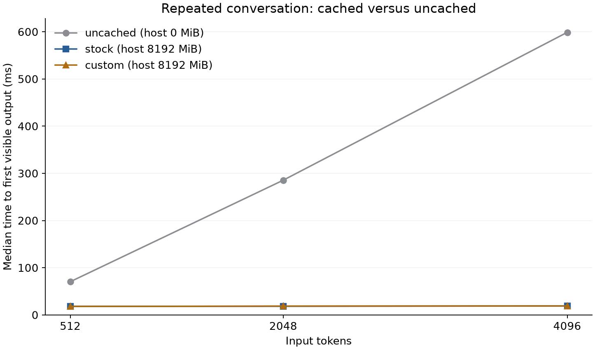
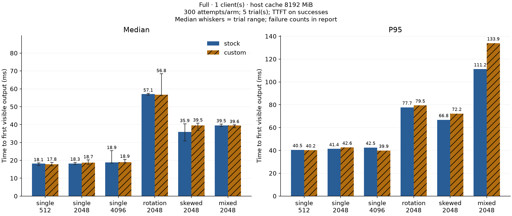
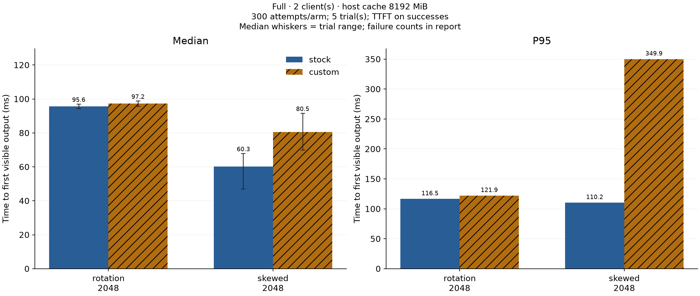
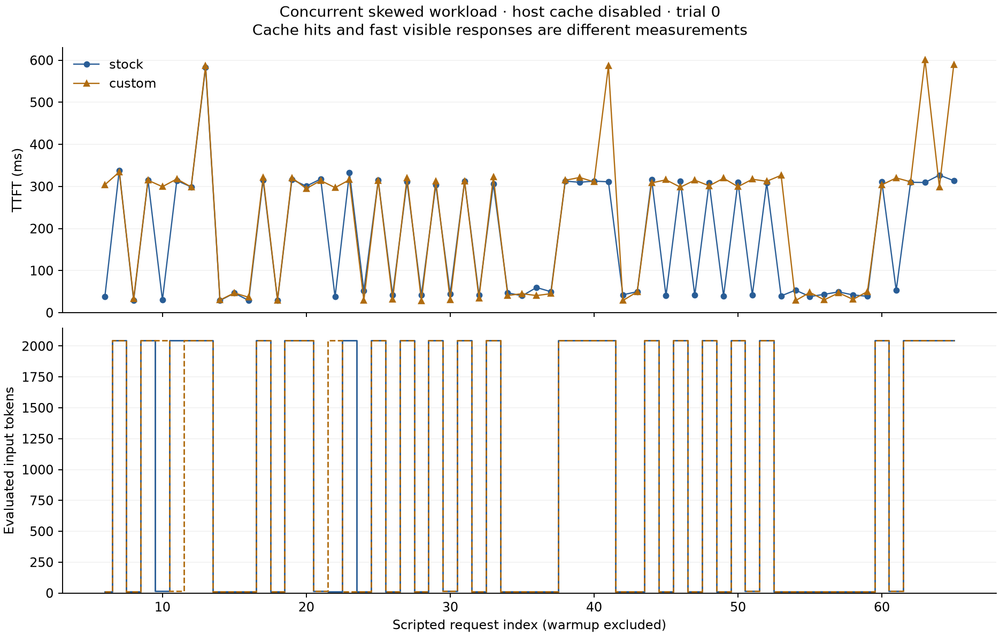

# When does conversation-aware eviction help local inference?

## Findings

On an RTX 4070 Laptop GPU, stock prompt caching reduced the median TTFT of the repeated 2,048-token conversation from **285.5 ms** uncached to **18.3 ms**. This is the caching baseline, not a gain attributable to Rust scheduling.

Against stock caching with the same 8,192 MiB host-cache budget, custom scheduling's paired median changes ranged from **-30.0%** to **+6.0%** across the eight workload/client configurations. Positive values mean faster custom scheduling. These are trace-specific comparisons on one device, not a universal speedup.

The mixed-length, single-client comparison changed by **-0.6%**, with exploratory paired-bootstrap 95% interval **[-0.9, +2.2]%**. See the full matrix below, including P95 regressions.

## Study and implementation

The Rust implementation keeps longest-prefix matching, then changes miss eviction to retain prefixes with higher token cost and greater frequency in the preceding 32 admissions. It uses no future request information. llama.cpp performs inference and validates all actual cache reuse.

The repeated study comprises **200 fresh-server arms and 12,000 measured request attempts**, plus 1,200 labeled warmup requests. The retained matrix includes **4 failed measured requests and 1 failed warmup request**. Latency summaries condition on successful responses; failures are not assigned zero latency. Every configuration has five paired trial seeds with 60 measured attempts each. The model is Qwen2.5-3B-Instruct Q4_K_M, running llama.cpp b11960's CUDA 12.4 binaries. There are two fixed slots with 6,144 tokens each. Timing runs generate eight tokens. Launch arguments, fixtures and retained raw counters accompany the results.

TTFT starts with a prepared request and ends at the first nonempty streamed output. Tokenization and model loading are outside that interval. The main workload uses one or two closed-loop clients; it is not an open-loop service-load test.

## Main comparison: stock host caching enabled

Both policies receive the same 8,192 MiB host-RAM cache budget. Each row contains 300 measured attempts per policy. Median columns show the median of the five trial medians, matching the paired change and interval. P95 pools successful responses; failure counts appear separately. The plots and `summary.json` also retain pooled request medians. All latency statistics condition on success.

| Workload | Clients | Stock median ms | Custom median ms | Paired change % | 95% interval % | Stock P95 ms | Custom P95 ms | Failures stock/custom |
|---|---:|---:|---:|---:|---|---:|---:|---:|
| single-512 | 1 | 18.40 | 17.30 | +6.0 | [-1.4, +6.0] | 40.49 | 40.24 | 0 / 1 |
| single-2048 | 1 | 18.29 | 17.93 | +1.9 | [-9.7, +2.1] | 41.36 | 42.62 | 0 / 0 |
| single-4096 | 1 | 18.82 | 18.90 | -0.4 | [-1.5, +24.6] | 42.52 | 39.90 | 0 / 0 |
| rotation-2048 | 1 | 57.08 | 56.65 | +0.7 | [-20.3, +1.8] | 77.68 | 79.47 | 0 / 0 |
| rotation-2048 | 2 | 95.25 | 97.04 | -1.9 | [-4.7, +0.3] | 116.48 | 121.92 | 0 / 0 |
| skewed-2048 | 1 | 35.26 | 38.56 | -9.3 | [-28.3, +4.7] | 66.77 | 72.25 | 0 / 0 |
| skewed-2048 | 2 | 60.83 | 79.06 | -30.0 | [-94.8, -9.2] | 110.16 | 349.93 | 0 / 0 |
| mixed-2048 | 1 | 39.34 | 39.58 | -0.6 | [-0.9, +2.2] | 111.22 | 133.94 | 0 / 0 |

The single-conversation rows are controls with no competing history to evict. Small timing differences there cannot establish an eviction-policy benefit. Use the multi-conversation rows and their uncertainty when assessing the policy; even those require representative traces before deployment.

## Constrained comparison: host cache disabled

This removes the stock RAM-cache safety net from both policies. It isolates slot retention, but must not be substituted for the default-caching baseline. Some workloads can reduce average recomputation without changing the median because fewer than half of requests benefit.

| Workload | Clients | Stock median ms | Custom median ms | Paired change % | 95% interval % | Stock P95 ms | Custom P95 ms | Failures stock/custom |
|---|---:|---:|---:|---:|---|---:|---:|---:|
| single-512 | 1 | 17.74 | 17.17 | +3.2 | [-0.7, +11.4] | 41.65 | 39.89 | 0 / 0 |
| single-2048 | 1 | 18.01 | 19.28 | -7.0 | [-8.1, +8.5] | 41.53 | 38.27 | 0 / 0 |
| single-4096 | 1 | 19.51 | 18.81 | +3.6 | [-15.9, +3.6] | 39.55 | 43.05 | 0 / 0 |
| rotation-2048 | 1 | 289.66 | 289.83 | -0.1 | [-1.8, +0.6] | 309.51 | 314.99 | 0 / 0 |
| rotation-2048 | 2 | 325.38 | 452.13 | -39.0 | [-44.2, +0.6] | 601.61 | 601.87 | 1 / 0 |
| skewed-2048 | 1 | 18.70 | 18.95 | -1.4 | [-62.1, +21.9] | 289.19 | 292.03 | 0 / 0 |
| skewed-2048 | 2 | 47.74 | 300.20 | -528.8 | [-547.8, -66.6] | 328.97 | 588.88 | 2 / 0 |
| mixed-2048 | 1 | 18.18 | 19.03 | -4.7 | [-8.3, +2.9] | 600.65 | 603.54 | 0 / 0 |

### Investigating the concurrent regression

In the exploratory first-trial skewed, two-client case with host caching disabled, stock evaluated 57,653 input tokens and custom evaluated 57,653; they had 32 and 32 requests with more than 1,000 reused tokens. Their medians were 56.7 and 302.7 ms; their means were 177.6 and 229.8 ms. Only 31 stock and 22 custom requests finished TTFT below 100 ms. A few requests crossing the middle of this bimodal distribution can produce a much larger median ratio than mean ratio.

Concurrent batching, request overlap, and slot availability can affect latency beyond total cache hits. External slot reservation waits for the client to finish receiving a response, while the engine observes its own slot state directly. This is a mechanism to investigate, not a causal finding established by this trace. The diagnostic uses trial 0 only; the five-trial matrix above is the primary comparison.

## Why the numbers can change

Stock llama.cpp already matches common prefixes and saves/restores displaced prompts in host RAM. An eviction heuristic has an opportunity when it keeps a frequently reused history resident, avoiding later prefill or restore work. It can also preserve an outdated hot history, change which idle slot receives a request, or add routing overhead. A latency difference without a corresponding change in reuse should not automatically be attributed to smarter eviction.

| Configuration | Policy | Median reused input tokens | Median evaluated input tokens | Median prefill ms | Median scheduling microseconds |
|---|---|---:|---:|---:|---:|
| Mixed, host 8192 MiB | stock | 2035 | 13 | 16.41 | 0.10 |
| Mixed, host 8192 MiB | custom | 2035 | 13 | 16.51 | 1.80 |
| Mixed, host 0 MiB | stock | 2034 | 13 | 16.84 | 0.10 |
| Mixed, host 0 MiB | custom | 2034 | 13 | 16.82 | 1.70 |

With host caching disabled, the custom scheduler's prefix prediction exceeded the engine's actual reused-input count on 0 of 2,400 measured requests. With host caching enabled, the engine reused more than the slot-local prediction on 802 of 2,399 requests. This is direct evidence that the RAM-cache layer adds reuse beyond the Rust slot metadata; it is a separate check from output quality.

The separate Nsight Systems capture contains CUDA matrix multiplication, matrix-vector, attention, memory-transfer, and synchronization activity. Its kernel summary includes startup and multiple requests, so it is not a per-request bottleneck attribution. The trace and summary are in `results/profile/` and are excluded from every timing chart.

## Correctness and quality

The correctness suite uses greedy generation with EOS enabled and up to 32 tokens. It measures factual recall separately from exact formatting. The initial probe design sometimes failed in a fresh uncached process; revised fixtures include a recent scripted confirmation. The original diagnostics remain available and are excluded from the final timing matrix.

| Correctness arm | Factual passes / requests | Exact-format matches | Exact generated-token agreement with uncached |
|---|---:|---:|---:|
| mixed-2048-c1-custom-ram0 | 65 / 66 | 64 | 65 / 66 |
| mixed-2048-c1-custom-ram8192 | 65 / 66 | 64 | 65 / 66 |
| mixed-2048-c1-stock-ram0 | 65 / 66 | 60 | 61 / 66 |
| mixed-2048-c1-stock-ram8192 | 65 / 66 | 64 | 65 / 66 |
| mixed-2048-c1-uncached-ram0 | 65 / 66 | 65 | baseline |
| rotation-2048-c1-custom-ram0 | 66 / 66 | 63 | 63 / 66 |
| rotation-2048-c1-custom-ram8192 | 66 / 66 | 64 | 64 / 66 |
| rotation-2048-c1-stock-ram0 | 66 / 66 | 63 | 63 / 66 |
| rotation-2048-c1-stock-ram8192 | 66 / 66 | 64 | 64 / 66 |
| rotation-2048-c1-uncached-ram0 | 66 / 66 | 64 | baseline |

These counts include six warmup and 60 measured requests per arm. The repeated mixed-workload factual miss is also present in its uncached baseline. Exact generated-token differences remain and are not claimed to establish bitwise equivalence. Backend batch-size changes are one possible contributor; these probes cannot establish general model-quality preservation.

The validation audit reconciled **15,241** completed requests' cache/evaluation counts and **15,241** evaluated-token counts against engine logs. Unit tests cover prefix changes, busy-slot handling, eviction, scope reset, cancellation, FIFO admission and streaming boundaries. Live controls exercise oversized requests, changed scope, and changed system instructions; see `results/negative-controls/checks.json`.

## Memory and secondary experiments

A one-trial secondary study varies f16/q8_0 KV precision and 9,216/16,384 total context tokens. This measures allocation and latency tradeoffs while the 3B model fits; it does not demonstrate behavior near the 8 GB capacity limit. Short output differences must not be treated as a full quality evaluation.

| KV type | Total context | Workload | Policy | Median TTFT ms | Sampled device-wide GPU peak MiB |
|---|---:|---|---|---:|---:|
| f16 | 9216 | rotation-2048 | custom | 56.59 | 3610 |
| f16 | 16384 | rotation-2048 | custom | 57.38 | 3869 |
| q8_0 | 9216 | rotation-2048 | custom | 41.98 | 3465 |
| q8_0 | 16384 | rotation-2048 | custom | 41.81 | 3605 |
| f16 | 9216 | rotation-2048 | stock | 57.31 | 3610 |
| f16 | 16384 | rotation-2048 | stock | 59.16 | 3866 |
| q8_0 | 9216 | rotation-2048 | stock | 42.55 | 3465 |
| q8_0 | 16384 | rotation-2048 | stock | 42.56 | 3603 |
| f16 | 9216 | single-4096 | custom | 18.61 | 3613 |
| f16 | 16384 | single-4096 | custom | 23.29 | 3869 |
| q8_0 | 9216 | single-4096 | custom | 20.51 | 3464 |
| q8_0 | 16384 | single-4096 | custom | 30.15 | 3603 |
| f16 | 9216 | single-4096 | stock | 21.13 | 3611 |
| f16 | 16384 | single-4096 | stock | 20.19 | 3866 |
| q8_0 | 9216 | single-4096 | stock | 20.78 | 3464 |
| q8_0 | 16384 | single-4096 | stock | 20.15 | 3603 |

In the one-trial stock 4,096-token workload with 16,384 total context, sampled device-wide GPU peak was 3866 MiB with f16 and 3603 MiB with q8_0, a difference of 263 MiB. This is an observed allocation tradeoff on this setup, not evidence that quantization uniformly improves latency or preserves output quality.

The secondary study also compares exact output-token sequences under f16 and q8_0 for the same scripted requests. Each is an eight-token reply; disagreement demonstrates a numerical/output difference, not a measured semantic-quality loss.

| Workload | Total context | Policy | Exact f16/q8_0 output matches |
|---|---:|---|---:|
| rotation-2048 | 16384 | custom | 59 / 60 |
| rotation-2048 | 9216 | custom | 59 / 60 |
| rotation-2048 | 16384 | stock | 59 / 60 |
| rotation-2048 | 9216 | stock | 59 / 60 |
| single-4096 | 16384 | custom | 59 / 60 |
| single-4096 | 9216 | custom | 59 / 60 |
| single-4096 | 16384 | stock | 59 / 60 |
| single-4096 | 9216 | stock | 59 / 60 |

GPU samples are approximately one second apart, device-wide, include loading and desktop activity, and can miss transient peaks. Process RSS is system RAM. Preserving more useful tokens inside an already allocated KV buffer does not itself reduce allocated VRAM.

## Collection failure and recovery

Trial 3's skewed, two-client stock arm with host cache disabled first recorded an HTTP connection-close error on request 26. Collection stopped and that whole arm was restarted. The first resume overwrote the original raw JSONL before archival was implemented; its inspected error summary survives in `results/failed-attempts/observed-http-failure.json`. The second attempt recorded two connection-close errors (requests 39 and 48). Its complete request file is retained in the matrix, including those failures, and archived separately. Collection then continued without per-request retries. The retained matrix contains 4 failed measured requests; latency is conditional on success. The first attempt's missing raw timings limit fault analysis and may introduce selection effects. The transport fault's root cause remains unresolved. Resumes now preserve incomplete attempts, and failure-containing runs that recorded every planned request are retained with explicit failure counts.

## Interpretation and limits

Keep stock caching as the general starting point. Adopt a different eviction policy only after its gains and tail-latency costs hold on representative traces and memory budgets. This study supports configuration-specific observations on one Windows laptop, not mobile, battery-life, or multi-device conclusions.

The main limits are synthetic repetitive histories, short output runs, five trial blocks, multiple exploratory comparisons, background desktop/controller activity, and no enforced thermal equilibrium. The laptop was observed plugged in under the Balanced power scheme, but AC state was not logged continuously. The server is reset per arm, so the study does not measure cold model startup or every long-lived-cache state.

Reproduce with the commands in the README. Exact definitions and aggregation are in [METHODS.md](METHODS.md); inspect `analysis/summary.json`, `comparisons.json`, `resources.json` and `validation.json` for evidence and uncertainty. All figures are generated from completed raw runs, and no illustrative speedups are used.

## Retained request failures

This inventory includes measured and warmup failures. It is separate from the overwritten first attempt summarized in the collection-history section.

| Workload | Trial | Clients | Policy | Host MiB | Phase | Request | Error |
|---|---:|---:|---|---:|---|---:|---|
| skewed-2048 | 3 | 2 | stock | 0 | measured | 39 | error sending request for url (http://127.0.0.1:8087/completion): client error (SendRequest): connection closed before message completed |
| skewed-2048 | 3 | 2 | stock | 0 | measured | 48 | error sending request for url (http://127.0.0.1:8087/completion): client error (SendRequest): connection closed before message completed |
| rotation-2048 | 4 | 2 | stock | 0 | measured | 35 | error sending request for url (http://127.0.0.1:8087/completion): client error (SendRequest): connection closed before message completed |
| single-512 | 4 | 1 | custom | 8192 | measured | 11 | error sending request for url (http://127.0.0.1:8087/completion): client error (SendRequest): connection closed before message completed |
| single-512 | 4 | 1 | custom | 8192 | warmup | 2 | error sending request for url (http://127.0.0.1:8087/completion): client error (SendRequest): connection closed before message completed |

## Sensitivity to observed transport failures

A request that was not received can also change later cache state. The affected arm is therefore a confounded policy comparison, not merely a missing latency value. The primary matrix keeps all observations. This post hoc check omits each affected trial from both policies; it does not recover the lost first-attempt data or prove a transport cause.

| Workload | Clients | Host cache MiB | Omitted trials | Remaining paired trials | Paired change % |
|---|---:|---:|---|---:|---:|
| rotation-2048 | 2 | 0 | [4] | 4 | -18.0 |
| single-512 | 1 | 8192 | [4] | 4 | +2.7 |
| skewed-2048 | 2 | 0 | [3] | 4 | -483.2 |
