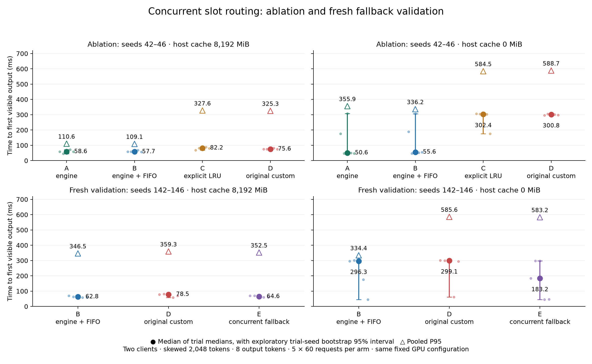

# Concurrent scheduling ablation and fresh validation

## Protocol

Use llama.cpp b11960 CUDA 12.4, Qwen2.5-3B-Instruct Q4_K_M, full GPU offload, two separate 6,144-token slots, f16 KV, flash attention on, logical batch 2,048, no automatic context shift, and `--fit off`. Both the main 8,192 MiB host-cache setting and the constrained 0 MiB setting receive identical treatment. No paid services or remote inference are used.

Every timing arm has six separate warmups and 60 measured attempts, two closed-loop outstanding requests, eight output tokens, temperature 0, seed 42, EOS ignored for fixed output length. Inputs come from saved tokenized synthetic histories; generated answers never enter later prompts. The fixture seed controls the conversation sequence, not a guarantee of identical floating-point behavior or engine interleaving. The client records TTFT from prepared-request creation to first nonempty content. Tokenization, model loading and analysis are outside this interval.

| Arm | Admission | Routing | Eviction |
|---|---|---|---|
| A: stock | Two-request window, no Rust semaphore | Native `id_slot = -1` | llama.cpp |
| B: stock + FIFO | Original fair two-permit semaphore | Native `id_slot = -1` | llama.cpp |
| C: explicit LRU | Same FIFO | Rust longest prefix above 10%, else empty/LRU | No frequency weighting |
| D: original custom | Same FIFO | Original Rust prefix and frequency policy | Cached tokens × prior-32-admission frequency |
| E: corrected | Same FIFO | Native `id_slot = -1` under concurrency | llama.cpp |

**The original project's stock mode is B.** E deliberately has the same concurrent routing semantics as B. It is measured independently to validate the fallback, not to suggest a new native scheduling algorithm. In the main CLI, corrected mode retains explicit custom routing only at concurrency 1.

The clean ablation uses five paired fixture seeds 42–46, rotating A/B/C/D order, with a fresh server per arm: **40 arms, 2,400 measured attempts and 240 warmups**. Normal log level is 3. No diagnostic slot polling, progress events, injected lease delay or fresh-connection control is enabled. A later, independently collected validation uses seeds 142–146 and rotates B/D/E: **30 arms, 1,800 measured attempts and 180 warmups**. Separate concurrent correctness probes use EOS-enabled 32-token responses, seeds 142–143 and all three B/D/E arms under both cache settings.

## Results

<!-- GENERATED_TABLES_START -->

### Clean ablation (seeds 42–46)

| Host MiB | Arm | Median ms | P95 ms | Eval tokens | Reused tokens | Queue median µs | Schedule median µs | Failures |
|---:|---|---:|---:|---:|---:|---:|---:|---:|
| 8192 | A: engine | 58.61 | 110.56 | 16181 | 598219 | 0.00 | 0.10 | 0 |
| 8192 | B: engine + FIFO | 57.70 | 109.07 | 16180 | 598220 | 0.20 | 0.10 | 0 |
| 8192 | C: explicit LRU | 82.17 | 327.65 | 20250 | 594150 | 0.20 | 0.70 | 0 |
| 8192 | D: original custom | 75.57 | 325.27 | 20249 | 594151 | 0.20 | 1.50 | 0 |
| 0 | A: engine | 50.57 | 355.85 | 251714 | 362686 | 0.00 | 0.10 | 0 |
| 0 | B: engine + FIFO | 55.57 | 336.22 | 253745 | 360655 | 0.30 | 0.10 | 0 |
| 0 | C: explicit LRU | 302.36 | 584.46 | 300455 | 313945 | 0.30 | 0.70 | 0 |
| 0 | D: original custom | 300.77 | 588.74 | 300455 | 313945 | 0.30 | 1.50 | 0 |

### Fresh validation (seeds 142–146)

| Host MiB | Arm | Median ms | P95 ms | Eval tokens | Reused tokens | Queue median µs | Schedule median µs | Failures |
|---:|---|---:|---:|---:|---:|---:|---:|---:|
| 8192 | B: engine + FIFO | 62.77 | 346.49 | 26350 | 588050 | 0.30 | 0.10 | 0 |
| 8192 | D: original custom | 78.48 | 359.33 | 28370 | 583982 | 0.20 | 1.50 | 1 |
| 8192 | E: concurrent fallback | 64.59 | 352.49 | 26350 | 588050 | 0.20 | 0.10 | 0 |
| 0 | B: engine + FIFO | 296.32 | 334.39 | 292336 | 322064 | 0.30 | 0.10 | 0 |
| 0 | D: original custom | 299.13 | 585.61 | 296398 | 318002 | 0.30 | 1.60 | 0 |
| 0 | E: concurrent fallback | 183.25 | 583.19 | 263906 | 350494 | 0.30 | 0.10 | 0 |


<!-- GENERATED_TABLES_END -->

Tables are regenerated by `scripts/concurrency_report.py`; their machine-readable counterpart is [`phase2/analysis-final/summary.json`](../DATA_ARCHIVE.md). Median columns use the median of five trial medians. P95 columns pool successful requests; failed attempts remain in the denominator and raw evidence but have no assigned latency. Evaluated/reused-token sums cover successful measured responses; native metrics also cover warmups and can include work not returned to a failed client.



Intervals resample the five independent trial seeds, with pairing preserved for differences. They are exploratory 95% percentile bootstrap intervals (20,000 resamples, analysis seed 20261029), not precise population guarantees. Five trials and a bimodal distribution produce wide or unstable median intervals. Per-trial values are retained alongside pooled distributions. The figure uses trial-level median intervals and pooled P95 markers; it does not display an interval for pooled P95.

**The fresh fallback did not establish reliable tail parity with stock.** At cache 0 MiB, B had 13/300 requests above 500 ms, E 17/300 and D 27/300. The 95th-percentile cutoff falls on opposite sides of that small tail group for B and E: pooled P95 is 334.39 versus 583.19 ms, even though the median paired per-trial P95 increase E/B is only 1.60%. Both statistics are retained; they answer different questions. The machine-readable analysis also resamples paired whole trials and recomputes the pooled P95 ratio. No conclusion of acceptable tails is based on the smaller per-trial statistic. Stock remains preferable; E is an opt-in routing correction, not a demonstrated overall optimization.

## Timing and server diagnostics

Each schema-2 JSONL begins with configuration, model/template properties, slot capacity and clock origin. Each request records creation, queue entry/admission, reservation, dispatch, HTTP headers, first bytes, first complete SSE event, first nonempty content, terminal response, EOF and release/invalidation. Every complete SSE event and terminal timing counters are retained, alongside output tokens and failures. `server_acceptance_us` stays null: native completion does not expose exact network acceptance or a reliable user request ID. The harmless correlation header is not assumed to be logged.

Client monotonic intervals are direct measurements. POST/selection/launch/token/release intervals on the engine clock are direct log intervals. Cross-clock lease gaps and per-request task joins are inferred and labeled. The task join must match exact output token IDs and evaluation counters for every successful task in the run; otherwise it is rejected. Clock alignment is a feasible bound from dispatch-before-POST and launch-before-headers. It is not a confidence interval. See [root-cause evidence](concurrency-root-cause.md) for the missed-prefix and cold-prefill blocking chain.

The client saves native `/metrics` before warmup and after the measured phase, with wall-clock brackets around each poll. These polls are outside measured requests. Successful complete arms reconcile prompt/cache token counters against the sums including warmups. Native `requests_processing` and `requests_deferred` are endpoint snapshots, not continuous traces. `n_busy_slots_per_decode` describes observed batching; it is not GPU utilization. Client dispatch→EOF intervals and native launch→release intervals retain request overlap directly in raw traces. A warm request overlapping a cold launch→first-token interval is evidence of overlap, not proof of a particular CUDA kernel's execution time.

The following values are medians across the five trials. Client intervals run from dispatch through EOF/error; engine intervals run from native launch through release, after the completed six-request warmup barrier. Active engine slots include prompt/decode waiting and do not imply parallel CUDA kernels. Native busy-slots/decode and decode-call metrics include both warmup and measurement. The scopes differ deliberately and are not subtracted from one another.

<!-- GENERATED_OVERLAP_START -->

| Cohort | Host MiB | Arm | Client mean active | Engine mean active | Engine wall time ≥2 slots % | Native busy slots/decode | Native decode calls |
|---|---:|---|---:|---:|---:|---:|---:|
| ablation | 8192 | A: engine | 1.997 | 1.637 | 72.0 | 1.967 | 270 |
| ablation | 8192 | B: engine + FIFO | 1.997 | 1.631 | 72.2 | 1.970 | 269 |
| ablation | 8192 | C: explicit LRU | 1.998 | 1.543 | 68.4 | 1.970 | 269 |
| ablation | 8192 | D: original custom | 1.998 | 1.577 | 69.9 | 1.963 | 270 |
| ablation | 0 | A: engine | 1.996 | 1.783 | 78.6 | 1.775 | 298 |
| ablation | 0 | B: engine + FIFO | 1.996 | 1.709 | 71.3 | 1.746 | 303 |
| ablation | 0 | C: explicit LRU | 1.998 | 1.758 | 76.1 | 1.755 | 302 |
| ablation | 0 | D: original custom | 1.998 | 1.625 | 62.5 | 1.773 | 299 |
| validation | 8192 | B: engine + FIFO | 1.997 | 1.660 | 73.1 | 1.967 | 270 |
| validation | 8192 | D: original custom | 1.997 | 1.598 | 71.6 | 1.967 | 270 |
| validation | 8192 | E: concurrent fallback | 1.997 | 1.655 | 73.1 | 1.970 | 270 |
| validation | 0 | B: engine + FIFO | 1.996 | 1.805 | 80.6 | 1.752 | 302 |
| validation | 0 | D: original custom | 1.997 | 1.688 | 68.9 | 1.767 | 300 |
| validation | 0 | E: concurrent fallback | 1.997 | 1.787 | 78.8 | 1.773 | 299 |

<!-- GENERATED_OVERLAP_END -->

## Data inventory and exclusions

The earlier collections are retained, not silently replaced or pooled into headline results:

- `phase2/diagnostic-deep`, `diagnostic-other`, `diagnostic-ram`: short log-level-5 diagnostics, 12 measured requests per arm.
- `phase2/ablation`: complete five-trial, four-arm, two-cache verbose cohort. This supplies detailed mechanisms. Log overhead and changing background GPU memory use limit timing comparisons with the clean cohort.
- `phase2/ablation-normal`: 22 completed normal-log arms before free VRAM fell below the 3,584 MiB setup threshold. The incomplete next attempt is preserved. This unbalanced, environmentally changing cohort is not used for headline claims.
- `phase2/legacy-check` and `legacy-clean`: frozen Phase 1 executable replays before and after closing Edge. They retain failures and show sensitivity of absolute medians to run conditions. Closing Edge did not make every frozen replay reproduce the original stock median. No browser-causation claim follows from this sequence.
- `phase2/ablation-clean`, `validation`, `correctness`: the complete cohorts used above, collected after GPU memory headroom was restored. No timed failed request is retried.

All original `results/`, original charts, README, environment manifests and Phase 1 report/application documents are preserved. The intentionally edited main CLI source is archived at `phase2/baseline-source/main.rs`; original scheduler and streaming parser remain unchanged. The original binary and pre-correction instrumentation binary are retained locally under ignored `phase2/baseline/`. Per-arm input manifests fingerprint fixtures and client binaries; launch manifests include server/runtime/model checksums, driver and complete arguments. `phase2/integrity.json` audits preservation and fingerprints the final collections.

## Correctness and limitations

<!-- GENERATED_CORRECTNESS_START -->

| Host MiB | Arm | Attempts | Factual passes | Request failures | Other conversation codes | Token mismatches vs B |
|---:|---|---:|---:|---:|---:|---:|
| 8192 | E: concurrent fallback | 120 | 117 | 0 | 0 | 4 |
| 8192 | D: original custom | 120 | 118 | 0 | 0 | 4 |
| 8192 | B: engine + FIFO | 120 | 117 | 0 | 0 | 0 |
| 0 | E: concurrent fallback | 120 | 118 | 0 | 0 | 0 |
| 0 | D: original custom | 120 | 117 | 0 | 0 | 3 |
| 0 | B: engine + FIFO | 120 | 118 | 0 | 0 | 0 |

<!-- GENERATED_CORRECTNESS_END -->

Factual probes require the expected conversation code and reject every other known conversation code. Greedy token sequences are compared per paired request, independently of the factual pass flag. Any formatting/token variation is retained and reported; a mismatch alone is not declared cache corruption. Cancellation/error tests invalidate uncertain explicit metadata and return admission permits; corrected concurrent mode holds no external slot lease to update. Existing prefix edit, threshold/tie, system/model/template change, restart, FIFO and streaming tests remain active.

There are 15 factual failures among the 720 measured probes, including wrong invented codes rather than another conversation's known code. A follow-up audit in `phase2/probe-audit` uses ten distinct disputed/control prompts, two repetitions each under sequential and two-client execution, with `cache_prompt = false`. All 40 native responses confirm zero cached tokens and full input evaluation. The shared `I-007` error recurs in all four uncached repetitions of that prompt; verbose correct-answer variation also occurs without reuse under concurrency. `I-452` and `I-523` do not recur in those controls, so their exact cause remains unresolved. Inspected decoded prompt boundaries retain the correct system/assistant code and role markers. Numerical/batching variation is possible, not a proven explanation. No bitwise-equivalence or perfect-accuracy claim follows from these probes.

One-second telemetry samples GPU memory/free space, temperature, power, SM/memory clocks, utilization, process RSS and available RAM. The derived ranges are in [`analysis-final/telemetry.json`](../DATA_ARCHIVE.md). Samples include startup/warmup and do not capture per-request peaks, exclusive GPU ownership, or all host-cache allocations. No reduction in recomputed tokens is interpreted as lower VRAM. Background desktop activity, laptop thermals/power management, five seeds and this one synthetic workload constrain generalization. Nsight was not needed for the observed routing and engine-queue mechanism; remaining CUDA-level timing attribution is unresolved.

The new client records more events and writes larger JSONL rows than the frozen Phase 1 client. All A/B/C/D/E comparisons share this instrumentation; its effect on closed-loop interleaving is not assumed to be zero. Frozen-client replays are kept separately, rather than treated as identical observations from the new harness.

## Reproduce without overwriting evidence

Start in the repository, with the existing model, pinned binaries and `.venv` prepared as documented in the original README. Exit spare GPU-heavy apps and keep AC power connected. Setup fails explicitly below 3,584 MiB free VRAM; it does not change model, cache types, context or offload.

```powershell
cargo test --all-targets
cargo build --release --bins
.venv\Scripts\python.exe scripts/concurrency_experiment.py --suite diagnostic --trials 1 --requests 12 --verbosity 5 --out phase2/reproduce-diagnostic
.venv\Scripts\python.exe scripts/concurrency_experiment.py --suite ablation --trials 5 --requests 60 --verbosity 3 --out phase2/reproduce-ablation
.venv\Scripts\python.exe scripts/concurrency_experiment.py --suite validation --trials 5 --requests 60 --verbosity 3 --arms fifo custom corrected --workloads phase2/workloads --seed-start 142 --out phase2/reproduce-validation
.venv\Scripts\python.exe scripts/concurrency_experiment.py --suite correctness --trials 2 --requests 60 --verbosity 3 --arms fifo custom corrected --workloads phase2/workloads --seed-start 142 --out phase2/reproduce-correctness
.venv\Scripts\python.exe scripts/concurrency_analyze.py --source phase2/reproduce-diagnostic --out phase2/reproduce-diagnostic-analysis
```

Saved seeds 142–146 are included. `concurrency_prepare_holdout.py` can create new copies using fresh `--out` and `--log` paths; it refuses to overwrite preparation evidence. The collector resumes only complete arms with identical inputs, refuses incomplete directories and retains failed observations. Use a fresh output directory for another collection. Regenerate the **saved canonical** report/plot without GPU runs using:

```powershell
.venv\Scripts\python.exe scripts/concurrency_report.py
.venv\Scripts\python.exe -m unittest discover -s tests -v
.venv\Scripts\python.exe scripts/concurrency_audit.py
```

To analyze a new cohort, pass its path to `concurrency_analyze.py`. The before/after report intentionally reads only the named complete canonical cohorts, preventing accidental mixing with exploratory or partially collected runs.
