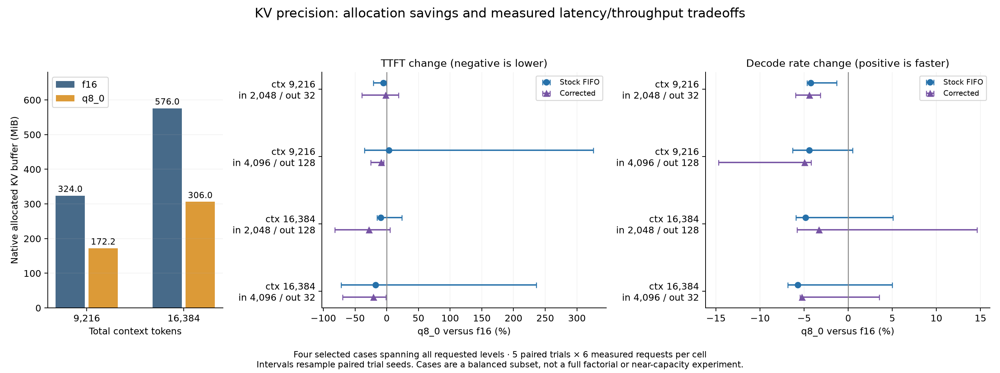

# Repeated KV-cache precision comparison

## Scope and design

This experiment follows the primary tail investigation and independently compares **f16** and **q8_0** KV-cache storage on the existing Qwen2.5-3B-Instruct Q4_K_M model. Both stock FIFO and corrected labels use native routing at concurrency 2. A result under one label is not evidence of a separate corrected scheduling algorithm.

Four cases were selected before collection:

| Total context | Per-slot capacity | Input tokens | Fixed output tokens |
|---:|---:|---:|---:|
| 9216 | 4608 | 2048 | 32 |
| 9216 | 4608 | 4096 | 128 |
| 16384 | 8192 | 2048 | 128 |
| 16384 | 8192 | 4096 | 32 |

Every case crosses both precisions and both labels, with **five paired trials**, independent seeded synthetic sequences 342–346, two labeled warmups and six measured requests per arm. This is **80 timing arms, 480 measured attempts and 160 warmups**. It spans all requested context/input/output levels but is **not a full factorial**: some context/input/output interactions cannot be isolated. Do not infer a pure context-size throughput effect from comparisons that also change input or output length.

Two closed-loop clients share the exact Phase 3 native request/parser path. Tokenized prompts and scripted continuations are fixed across each pair; generated answers never become future inputs. Generation is greedy, temperature 0, seed 42. Timing ignores EOS to enforce 32/128 tokens. Stock RAM caching remains at 8192 MiB; full GPU offload, flash attention, two fixed slots, batch 2048, context shifting off and fit off stay constant. Fresh server processes and rotating four-cell order reduce state/order confounding. Tests reject oversized requests rather than shrink the context or output.

An additional **20 arms, 120 measured probes and 40 warmups** enable EOS with a 32-token cap in the 16,384-context/4,096-input case, using all five trial seeds and all four precision/label cells. This separates natural-answer factual checks from forced-length timing output.

## Allocation is a separate measurement

Detailed-log calibration runs collect backend buffer sizes outside headline timing. Normal timing runs use log level 3. All five trials additionally record ready GPU usage and one-second system-wide memory samples during inference.

| Total context | f16 native KV MiB | q8_0 native KV MiB | KV allocation reduction |
|---:|---:|---:|---:|
| 9216 | 324.00 | 172.15 | about 46.9% |
| 16384 | 576.00 | 306.03 | about 46.9% |

These are directly printed GPU KV buffer sizes, rounded by the backend, not exact process VRAM or peak usage. The model buffer stays **1,834.83 MiB** in all four calibrations. Compute buffers are about 85–89 MiB and differ slightly with context/type. Thus a 46.9% KV-buffer saving is not a 46.9% total-VRAM saving. Native allocation records and launch arguments are in [`phase3/allocations`](../DATA_ARCHIVE.md).

Sampled timing maxima are restricted to the measured request window using recorded client/telemetry clocks. Samples may miss brief peaks, include unrelated Windows GPU activity, and have query-timestamp uncertainty. Ready usage, full-process-lifetime maxima, sample counts, temperatures, power and clocks remain in the machine-readable summaries. These runs have headroom; different context allocations are an allocation tradeoff, not proof of operation near capacity. Recomputing fewer tokens is not interpreted as lower allocation.

## Timing results

<!-- PRECISION_TABLE_START -->

| Context | Input | Output | Route | KV | Median TTFT ms | Decode tokens/s per stream | Prefill ms | Decode ms | End-to-end output tokens/s | Ready GPU MiB | Sampled timing peak GPU MiB | Failures | Factual passes |
|---:|---:|---:|---|---|---:|---:|---:|---:|---:|---:|---:|---:|---:|
| 9216 | 2048 | 32 | Corrected | f16 | 151.23 | 87.80 | 22.02 | 353.10 | 115.67 | 3771 | 3781 | 0 | 27/30 |
| 9216 | 2048 | 32 | Corrected | q8_0 | 132.11 | 83.81 | 30.78 | 369.95 | 109.62 | 3625 | 3633 | 0 | 28/30 |
| 9216 | 2048 | 32 | Stock FIFO | f16 | 335.76 | 88.22 | 297.74 | 351.42 | 104.64 | 3771 | 3781 | 0 | 27/30 |
| 9216 | 2048 | 32 | Stock FIFO | q8_0 | 332.62 | 84.56 | 307.55 | 366.59 | 103.13 | 3639 | 3645 | 0 | 27/30 |
| 9216 | 4096 | 128 | Corrected | f16 | 91.44 | 84.16 | 19.18 | 1509.06 | 141.30 | 3770 | 3780 | 0 | 30/30 |
| 9216 | 4096 | 128 | Corrected | q8_0 | 78.50 | 79.78 | 22.83 | 1591.91 | 135.48 | 3645 | 3654 | 0 | 30/30 |
| 9216 | 4096 | 128 | Stock FIFO | f16 | 96.01 | 84.09 | 22.68 | 1510.22 | 140.90 | 3770 | 3781 | 0 | 30/30 |
| 9216 | 4096 | 128 | Stock FIFO | q8_0 | 371.89 | 79.76 | 310.91 | 1592.23 | 123.17 | 3625 | 3635 | 0 | 30/30 |
| 16384 | 2048 | 128 | Corrected | f16 | 331.27 | 88.79 | 297.15 | 1430.35 | 152.93 | 4026 | 4041 | 0 | 27/30 |
| 16384 | 2048 | 128 | Corrected | q8_0 | 72.66 | 85.21 | 26.16 | 1490.40 | 155.97 | 3763 | 3772 | 0 | 28/30 |
| 16384 | 2048 | 128 | Stock FIFO | f16 | 62.53 | 89.98 | 18.54 | 1411.43 | 161.34 | 4027 | 4036 | 0 | 27/30 |
| 16384 | 2048 | 128 | Stock FIFO | q8_0 | 56.53 | 85.06 | 29.83 | 1493.03 | 154.07 | 3768 | 3771 | 0 | 27/30 |
| 16384 | 4096 | 32 | Corrected | f16 | 152.55 | 83.61 | 27.03 | 370.78 | 92.23 | 4026 | 4036 | 0 | 30/30 |
| 16384 | 4096 | 32 | Corrected | q8_0 | 70.23 | 79.20 | 25.40 | 391.41 | 92.41 | 3762 | 3770 | 0 | 30/30 |
| 16384 | 4096 | 32 | Stock FIFO | f16 | 158.96 | 83.46 | 22.79 | 371.49 | 95.23 | 4026 | 4036 | 0 | 30/30 |
| 16384 | 4096 | 32 | Stock FIFO | q8_0 | 74.08 | 78.96 | 22.78 | 392.59 | 91.55 | 3762 | 3770 | 0 | 30/30 |

<!-- PRECISION_TABLE_END -->

<!-- PRECISION_INTERPRETATION_START -->

All eight paired per-stream decode-rate point estimates are lower with q8_0: **3.34–5.70% slower**. Some five-trial intervals include improvements, so this is not a universal slowdown claim. TTFT is mixed and often very uncertain; one stock case has a +3.30% point estimate and an interval extending to +326.12%. Allocation savings do not establish lower latency.

| Context / input / output | Route | Paired TTFT change % [95% interval] | Paired decode-rate change % [95% interval] |
|---|---|---|---|
| 9216 / 2048 / 32 | corrected | -1.70 [-39.08, +18.87] | -4.41 [-5.97, -3.16] |
| 9216 / 2048 / 32 | fifo | -5.05 [-21.01, -0.39] | -4.24 [-4.65, -1.32] |
| 9216 / 4096 / 128 | corrected | -8.57 [-25.47, -4.74] | -4.95 [-14.71, -4.21] |
| 9216 / 4096 / 128 | fifo | +3.30 [-35.17, +326.12] | -4.41 [-6.30, +0.48] |
| 16384 / 2048 / 128 | corrected | -27.95 [-81.77, +5.06] | -3.34 [-5.82, +14.61] |
| 16384 / 2048 / 128 | fifo | -9.60 [-15.54, +24.09] | -4.84 [-5.94, +5.09] |
| 16384 / 4096 / 32 | corrected | -20.99 [-69.42, -1.25] | -5.27 [-5.47, +3.53] |
| 16384 / 4096 / 32 | fifo | -17.67 [-71.74, +236.10] | -5.70 [-6.84, +4.98] |

These paired percentage medians are not ratios of the medians in the preceding table. Cache/evaluated counts and batching vary between independent runs. For example, corrected mode at context 16,384/input 4,096 evaluates 28,943 measured tokens with f16 and 24,864 with q8_0; stock evaluates 28,943 with each. Do not attribute every TTFT change solely to quantization arithmetic. All 480 measured timing requests and 160 warmups succeeded.

<!-- PRECISION_INTERPRETATION_END -->

The table uses medians of five trial summaries. Native decode tokens/s is a **per-stream** counter, whose wall time can include overlap/interference; it is not aggregate system output throughput. The separate end-to-end output rate divides generated tokens by the measured dispatch→completion span and includes prefill. Prefill/decode times are native wall-clock timings, not isolated GPU kernel durations. Queue-inclusive TTFT is also retained.

Paired percentage changes resample entire five-trial blocks (10,000 bootstrap resamples), rather than treating 30 requests as independent. Intervals are exploratory, broad with only five blocks, and unadjusted for multiple cases. Positive decode-rate change means faster q8_0; negative TTFT change means lower latency. Changes in native cache/evaluated counters are retained, so TTFT differences are not automatically assigned to arithmetic conversion cost.

## Numerical behavior and correctness

After each timed arm and after its native metric snapshot, a separate cold control requests one token with `cache_prompt = false`, `n_probs = 8` and `post_sampling_probs = false`. Native counters must confirm zero cached tokens and full input evaluation. Those controls are outside headline timing and timing-memory windows. They capture the first token and the native top-eight pre-sampling log probabilities. Shared-candidate log-probability differences quantify a limited numerical comparison; they are not full logits, full-vocabulary KL divergence, perplexity or an accuracy benchmark.

<!-- PRECISION_CORRECTNESS_START -->

Timing token sequences differ in **197/240 f16/q8_0 paired outputs**, compared with **14/240 same-precision label comparisons**. Forced generation beyond EOS makes full-sequence divergence easier; these are not factual error rates. The cold controls switch their first-token argmax in **4/40 paired cells**. Maximum shared-candidate log-probability difference is **2.940 natural-log units**, including low-probability candidates. These cells repeat prompts across labels/contexts and are not independent input examples.

| EOS probe route | KV | Factual passes | Measured request failures |
|---|---|---:|---:|
| corrected | f16 | 30/30 | 0 |
| corrected | q8_0 | 30/30 | 0 |
| fifo | f16 | 30/30 | 0 |
| fifo | q8_0 | 30/30 | 0 |

All **120/120 selected EOS-enabled probes** pass the factual criterion, with zero measured or warmup request failures. There are **4/60 f16/q8_0 token-sequence mismatches** in these probes: f16 gives a verbose correct answer while q8_0 gives the exact code. Neither precision has a same-precision label mismatch in the EOS controls. This selected 4,096-input case does not establish perfect correctness for every workload or the 2,048-input cases. Timing outputs contain factual failures and remain inspectable.

<!-- PRECISION_CORRECTNESS_END -->

Timing-output checks require the expected conversation code and reject any other known conversation's code. Forced output beyond EOS can continue a synthetic dialogue, so those flags are descriptive and are not substituted for the separate EOS-enabled factual probes. Greedy token mismatches and wrong codes are retained. A difference can reflect numerical/batching variation or model behavior; it is not automatically KV corruption. The same-precision stock/corrected output comparisons provide a runtime-variation control. Residual mismatches are unresolved unless specific evidence explains them.

## Evidence and reproduction

- [Timing summary and paired comparisons](../DATA_ARCHIVE.md), [generated table](../DATA_ARCHIVE.md).
- [EOS correctness summary](../DATA_ARCHIVE.md).
- `phase3/precision/<arm>/`: input identity, request traces/output tokens, metrics, native log, GPU samples and cold numerical probe.
- `phase3/precision-workloads/`: exact prepared prompts, expected facts, seeds and model/template scope.
- [README commands](../README.md#reproduce-in-powershell) regenerate fixtures and raw collections in fresh directories. `scripts/phase3_precision_analyze.py` and `scripts/phase3_report.py` regenerate only derived outputs.

All failures remain counted and raw. No request is silently retried, no model/cache configuration changes on memory pressure, and no q8_0 latency advantage is assumed before measurement.
